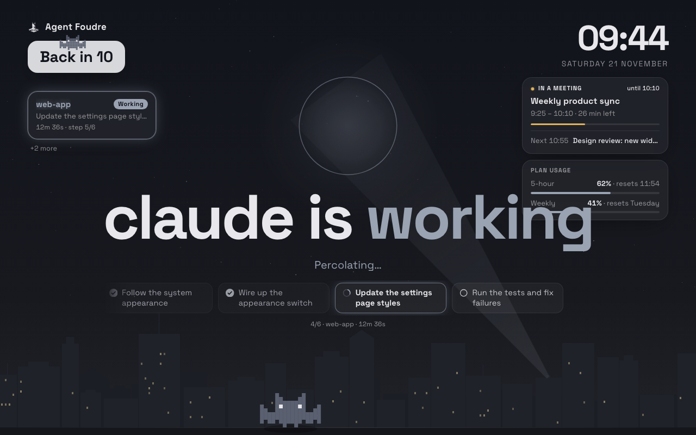

# Agent Foudre

A Gotham-night lock screen for your Mac that shows what your Claude Code sessions are doing while you're away.



Your Mac stays locked (macOS still asks for your password or Touch ID); the screensaver behind the lock shows each session's progress, so you can tell from across the room whether to come back now.

## What it shows

| | |
|---|---|
| **Live session status** | Every Claude Code session on this Mac: working, done, or waiting for you. The current session's task list slides along as it works. |
| **Needs-you alerts** | The screen glows when a session is waiting for your approval. |
| **Away message** | "Back in 10", "In a meeting", or your own text, in any language (right-to-left included). The bat plays with the letters. |
| **Calendar** | The meeting you're in and what's next, from iCal links (Google, Apple, Outlook). Google sign-in also works if you build with your own Google OAuth client (`GOOGLE_CLIENT_JSON=…`). |
| **Plan usage** | How much of your Claude plan's 5-hour and weekly limits you've used, and when they reset. |

On your Mac: a menu bar icon with the sessions' state, an optional keep-awake mode for long runs, an always-on display for a second monitor, and a lighter render on battery.

Everything runs locally. The server only answers requests from this Mac.

## Install from source

You need a Mac with Apple silicon, macOS 13 or later, [Claude Code](https://claude.com/claude-code), and **Node.js 24** for the build (the app embeds Node as a single-executable app; Homebrew's Node 26 is built without that feature).

```sh
git clone https://github.com/mryouling/own_screensaver.git
cd own_screensaver
node check.js                                  # optional: should end with "All checks passed"
NODE=/path/to/node-v24/bin/node ./install.sh   # builds, installs to /Applications and opens it
```

Then:

1. Click **Connect Claude Code** when asked, and restart Claude Code sessions that are already open.
2. Choose **Agent Foudre** in **System Settings → Screen Saver**. To keep the Mac locked while it shows, set Lock Screen → "Require password after screen saver begins" to **Immediately**.
3. If macOS asks to allow Agent Foudre in the background, allow it: that's the local server.

## Tips

- **Start it any time:** set a Hot Corner to "Start Screen Saver" (System Settings → Desktop & Dock → Hot Corners).
- **Set your message on the way out:** from the menu bar icon.
- **Second monitor:** Settings → Lock screen → **Always-on display**. Esc closes it.
- **Uninstall:** Agent Foudre menu → **Uninstall Agent Foudre…** removes the hooks, the background service and the screensaver; then drag the app to the Trash.

## How it works

Claude Code hooks write each session's state to `~/.claude/agent-foudre/sessions`, a small server on `127.0.0.1:4777` serves the lock screen page, and the screensaver shows it. [docs/TECHNICAL.md](docs/TECHNICAL.md) lists every file and setting it touches, the network requests it makes, and how to work on it.

## License

[MIT](LICENSE).
